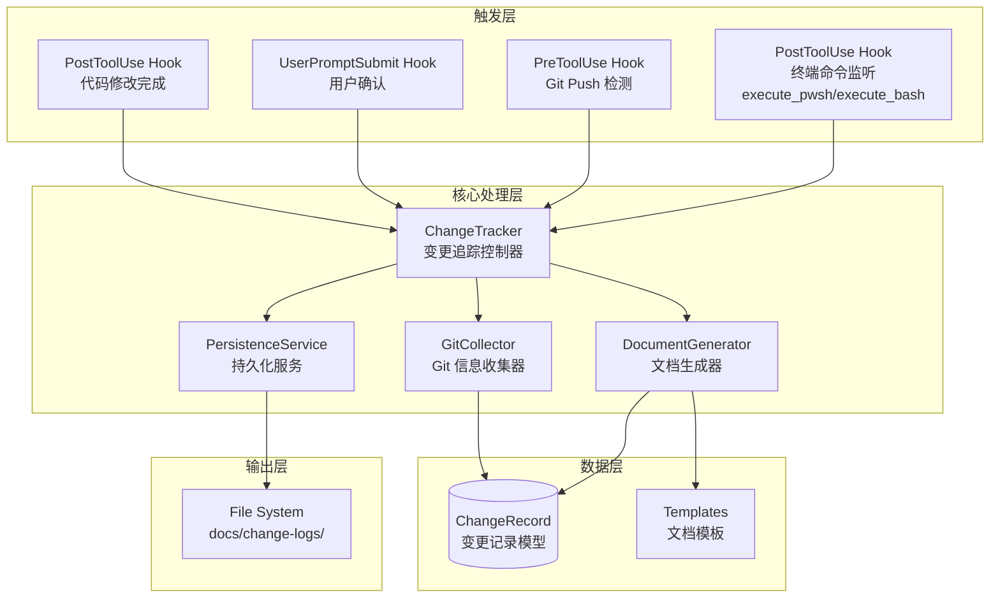
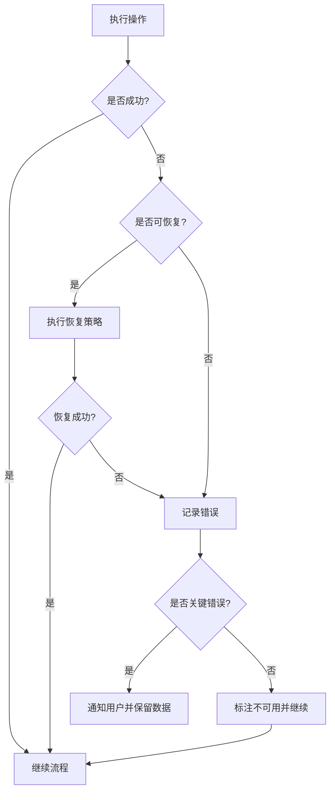

# Design Document: Change Tracking Skill

## Overview

Change Tracking Skill 是一个 Kiro Skill，通过 Hook 机制自动化变更记录的生成和持久化。该系统在代码修改完成后、用户确认修改成功时、或检测到 git push 操作时，自动收集变更信息并生成结构化的 Markdown 文档，存储到项目的 `docs/change-logs/` 目录。

### 核心功能

1. **事件监听与触发**：通过 Kiro Hooks 监听 `PostToolUse`（代码修改完成）、`UserPromptSubmit`（用户输入）、`PostTaskExec`（任务完成）等事件
2. **变更信息收集**：调用 Git CLI 获取分支、commit、文件差异等信息
3. **文档生成**：基于模板生成结构化的 Markdown 变更记录
4. **持久化存储**：将文档保存到指定目录，自动创建目录结构

### 设计目标

- **零侵入性**：不修改用户工作流，仅在合适时机提示
- **信息完整性**：自动收集尽可能多的上下文信息
- **格式一致性**：统一的文档结构便于阅读和检索
- **容错性**：Git 信息不可用时优雅降级

## Architecture

系统采用事件驱动架构，由 Kiro Hooks 作为入口触发变更追踪流程。



### 架构决策

1. **Hook 作为触发入口**：利用 Kiro 原生 Hook 机制，无需额外守护进程
2. **Agent Action 类型**：使用 `agent` 类型的 Hook action，让 Kiro Agent 执行变更追踪逻辑
3. **模块化设计**：收集、生成、持久化三个模块独立，便于测试和扩展
4. **Git CLI 直接调用**：通过 shell 命令调用 Git，避免额外依赖
5. **终端命令监听**：通过 PostToolUse Hook 监听 execute_pwsh/execute_bash 工具，检测用户通过 AI 执行的 git push 命令

## Components and Interfaces

### 1. Hook 配置组件

负责定义和管理触发变更追踪的 Kiro Hooks。

```typescript
// Hook 配置接口
interface HookConfig {
  version: "v1";
  hooks: Hook[];
}

interface Hook {
  name: string;
  description?: string;
  trigger: TriggerType;
  matcher?: string;  // 正则表达式，用于过滤触发事件
  action: HookAction;
  timeout?: number;
  enabled?: boolean;
}

type TriggerType = 
  | "PostToolUse"      // 工具使用后（如文件修改、终端命令执行）
  | "UserPromptSubmit" // 用户提交提示
  | "PreToolUse"       // 工具使用前（检测 git push）
  | "PostTaskExec"     // 任务执行完成后
  | "PostFileSave";    // 文件保存后

interface HookAction {
  type: "agent" | "command";
  prompt?: string;   // agent 类型使用
  command?: string;  // command 类型使用
}
```

#### 终端命令监听配置

为检测用户通过 AI 执行的 git push 命令，需要配置 PostToolUse Hook 监听终端执行工具：

```json
{
  "version": "v1",
  "hooks": [
    {
      "name": "terminal-git-push-detector",
      "description": "监听终端执行工具，检测 git push 命令",
      "trigger": "PostToolUse",
      "matcher": "execute_pwsh|execute_bash",
      "action": {
        "type": "agent",
        "prompt": "检查刚才执行的终端命令是否包含 'git push'。如果是，则触发变更记录生成流程。请分析命令内容并决定是否需要生成变更记录。"
      },
      "timeout": 30
    }
  ]
}
```

**matcher 说明**：
- `execute_pwsh|execute_bash`：正则表达式匹配 Windows PowerShell 和 Linux/macOS Bash 终端执行工具
- 当 Kiro Agent 使用这些工具执行命令后，Hook 会被触发

**检测逻辑**：
- Hook 触发后，Agent 需要检查执行的命令内容
- 如果命令包含 `git push`，则触发变更记录生成流程
- 如果命令不涉及 git push，则不执行任何操作

#### 完整 Hook 配置示例

```json
{
  "version": "v1",
  "hooks": [
    {
      "name": "code-modification-tracker",
      "description": "代码修改完成后询问是否生成变更记录",
      "trigger": "PostToolUse",
      "matcher": "fs_write|str_replace|fs_append",
      "action": {
        "type": "agent",
        "prompt": "代码修改已完成。是否需要生成变更记录？"
      }
    },
    {
      "name": "user-confirmation-tracker",
      "description": "用户确认修改成功时自动生成变更记录",
      "trigger": "UserPromptSubmit",
      "action": {
        "type": "agent",
        "prompt": "检查用户消息是否表示修改成功或确认完成。如果是，自动生成变更记录。"
      }
    },
    {
      "name": "terminal-git-push-detector",
      "description": "监听终端执行工具，检测 git push 命令",
      "trigger": "PostToolUse",
      "matcher": "execute_pwsh|execute_bash",
      "action": {
        "type": "agent",
        "prompt": "检查刚才执行的终端命令是否包含 'git push'。如果是，则在 push 完成后自动生成变更记录。请分析命令内容，如果确实执行了 git push，立即开始收集变更信息并生成记录。"
      },
      "timeout": 60
    }
  ]
}
```

### 2. ChangeTracker 控制器

变更追踪的核心控制器，协调各模块工作。

```typescript
interface ChangeTracker {
  /**
   * 询问用户是否需要生成变更记录
   * @returns 用户确认结果
   */
  promptForConfirmation(): Promise<UserConfirmation>;

  /**
   * 执行完整的变更追踪流程
   * @param context 触发上下文
   * @returns 生成的变更记录或 null（用户拒绝时）
   */
  track(context: TriggerContext): Promise<ChangeRecord | null>;

  /**
   * 判断是否应该触发变更追踪
   * @param context 触发上下文
   */
  shouldTrack(context: TriggerContext): boolean;
}

interface TriggerContext {
  triggerType: TriggerType;
  toolName?: string;      // 触发的工具名称
  filePaths?: string[];   // 涉及的文件路径
  userMessage?: string;   // 用户消息（用于判断确认意图）
  taskId?: string;        // 任务 ID
  terminalCommand?: string; // 终端执行的命令内容（用于检测 git push）
  terminalOutput?: string;  // 终端命令输出
}

interface UserConfirmation {
  confirmed: boolean;
  skipped: boolean;
  additionalInfo?: string;  // 用户提供的额外信息
}
```

### 3. GitCollector 信息收集器

负责从 Git 仓库收集变更相关信息。

```typescript
interface GitCollector {
  /**
   * 获取当前分支名称
   * @returns 分支名称或 null
   */
  getCurrentBranch(): Promise<string | null>;

  /**
   * 获取最近的 commit 信息
   * @param count 获取数量
   */
  getRecentCommits(count: number): Promise<CommitInfo[]>;

  /**
   * 获取指定范围的 commits
   * @param from 起始 commit hash
   * @param to 结束 commit hash（默认 HEAD）
   */
  getCommitRange(from: string, to?: string): Promise<CommitRange>;

  /**
   * 获取文件差异
   * @param commitHash commit hash 或 commit 范围
   */
  getFileDiff(commitHash: string): Promise<FileDiff[]>;

  /**
   * 获取修改的文件列表
   * @param commitHash commit hash 或 commit 范围
   */
  getChangedFiles(commitHash: string): Promise<ChangedFile[]>;

  /**
   * 检查是否在 Git 仓库内
   */
  isGitRepository(): Promise<boolean>;
}

interface CommitInfo {
  hash: string;
  shortHash: string;
  message: string;
  author: string;
  date: Date;
}

interface CommitRange {
  from: string;
  to: string;
  commits: CommitInfo[];
}

interface ChangedFile {
  path: string;
  status: "added" | "modified" | "deleted" | "renamed";
  additions: number;
  deletions: number;
  oldPath?: string;  // renamed 时的原路径
}

interface FileDiff {
  filePath: string;
  hunks: DiffHunk[];
}

interface DiffHunk {
  oldStart: number;
  oldCount: number;
  newStart: number;
  newCount: number;
  lines: DiffLine[];
}

interface DiffLine {
  type: "context" | "addition" | "deletion";
  content: string;
  oldLineNumber?: number;
  newLineNumber?: number;
}
```

### 4. DocumentGenerator 文档生成器

负责将收集的信息转换为结构化的 Markdown 文档。

```typescript
interface DocumentGenerator {
  /**
   * 生成变更记录文档
   * @param record 变更记录数据
   * @returns Markdown 格式的文档内容
   */
  generate(record: ChangeRecord): string;

  /**
   * 从变更概要中提取简短描述（用于文件名）
   * @param summary 变更概要
   * @returns 简短描述（通常 2-4 个中文词或 3-5 个英文单词）
   */
  extractShortDescription(summary: string): string;

  /**
   * 生成文件名
   * @param record 变更记录
   * @returns 格式：YYYY-MM-DD_HHmmss_简短描述.md
   */
  generateFileName(record: ChangeRecord): string;

  /**
   * 智能推荐标签
   * @param record 变更记录
   * @returns 推荐的标签列表
   */
  suggestTags(record: ChangeRecord): string[];

  /**
   * 评估 Bug 严重程度
   * @param record 变更记录
   * @returns 严重程度评估
   */
  assessSeverity(record: ChangeRecord): Severity | null;
}
```

### 5. PersistenceService 持久化服务

负责将生成的文档保存到文件系统。

```typescript
interface PersistenceService {
  /**
   * 保存变更记录文档
   * @param content 文档内容
   * @param fileName 文件名
   * @returns 保存的文件路径
   */
  save(content: string, fileName: string): Promise<string>;

  /**
   * 确保目录存在
   * @param dirPath 目录路径
   */
  ensureDirectory(dirPath: string): Promise<void>;

  /**
   * 获取变更记录存储目录
   * @returns 目录路径（项目根目录/docs/change-logs/）
   */
  getStorageDirectory(): string;
}

interface PersistenceError {
  code: "PERMISSION_DENIED" | "DISK_FULL" | "PATH_TOO_LONG" | "UNKNOWN";
  message: string;
  originalError?: Error;
}
```

## Data Models

### ChangeRecord 变更记录模型

```typescript
interface ChangeRecord {
  // 元信息
  id: string;                     // 唯一标识符（UUID）
  createdAt: Date;                // 创建时间
  completedAt: Date;              // 完成时间
  
  // Git 信息
  branch: string | null;          // 分支名称，null 表示不可用
  commitHash: string | null;      // 单个 commit 的 hash，null 表示不可用
  commitRange: CommitRange | null; // 多 commit 时的范围
  
  // 变更分类
  changeType: ChangeType;         // 变更类型
  severity: Severity | null;      // 严重程度（仅 Bug 修复时有值）
  tags: string[];                 // 标签列表
  
  // 变更内容
  summary: string;                // 变更概要
  description: string;            // 详细描述
  changedFiles: ChangedFileDetail[]; // 修改的文件列表
  
  // 分析内容
  rootCause: RootCauseAnalysis | null;  // 根因分析（仅 Bug 修复）
  pitfalls: PitfallRecord[];            // 踩坑记录
  impactAnalysis: ImpactAnalysis;       // 影响分析
  codeDiff: CodeDiffSection;            // 代码差异
}

// 变更类型枚举
type ChangeType = 
  | "Bug修复"
  | "新功能"
  | "重构"
  | "性能优化"
  | "配置变更"
  | "文档更新"
  | "依赖升级";

// 严重程度枚举
type Severity = "high" | "medium" | "low";

// 修改文件详情
interface ChangedFileDetail {
  filePath: string;               // 文件路径
  status: "added" | "modified" | "deleted" | "renamed";
  modifications: FileModification[];
}

interface FileModification {
  location: string;               // 修改位置（行号范围或函数名）
  change: string;                 // 具体改动描述
  reason: string;                 // 修改原因
}

// 根因分析
interface RootCauseAnalysis {
  symptom: string;                // 问题表现症状
  cause: string;                  // 根本原因
}

// 踩坑记录
interface PitfallRecord {
  type: "blocking" | "misjudgment" | "mismodification";
  problem: string;                // 问题描述
  solution?: string;              // 解决方案（blocking 类型）
  analysis?: string;              // 原因分析（misjudgment/mismodification 类型）
}

// 影响分析
interface ImpactAnalysis {
  hasExternalImpact: boolean;     // 是否有外部影响
  interfaceChanges?: string[];    // 接口变更描述
  dataStructureChanges?: string[]; // 数据结构变更
  affectedModules?: string[];     // 受影响的模块
}

// 代码差异章节
interface CodeDiffSection {
  keyChanges: KeyCodeChange[];    // 关键代码变更
  bulkChangeSummary?: string[];   // 批量变更摘要
  commitLinks: string[];          // commit 链接
}

interface KeyCodeChange {
  filePath: string;               // 文件路径
  lineRange: string;              // 行号范围
  changeType: "core_logic" | "interface" | "algorithm";
  before: string;                 // 修改前代码
  after: string;                  // 修改后代码
  description: string;            // 变更说明
}
```

### 文档模板结构

```markdown
# {变更标题}

## 元信息

| 属性 | 值 |
|------|-----|
| ID | {uuid} |
| 创建时间 | {YYYY-MM-DD HH:mm:ss} |
| 完成时间 | {YYYY-MM-DD HH:mm:ss} |
| 分支 | {branch_name 或 "分支信息不可用"} |
| Commit | {commit_hash 或 commit_range 或 "Commit 信息不可用"} |
| 类型 | {change_type} |
| 严重程度 | {severity，仅 Bug 修复显示} |
| 标签 | {tags，逗号分隔} |

## 变更概要

{summary}

## 详细描述

{description}

## 修改文件列表

| 文件路径 | 状态 |
|---------|------|
| {file_path} | {status} |

## 具体改动

### {file_path}

- **位置**: {location}
- **改动**: {change}
- **原因**: {reason}

## 根因分析

> 仅 Bug 修复时显示此章节

### 问题症状

{symptom}

### 根本原因

{cause}

## 踩坑记录

> 无特殊问题时显示"无"

### {问题类型}

- **问题**: {problem}
- **解决方案/原因分析**: {solution/analysis}

## 影响分析

> 无外部影响时显示"无外部影响"

### 接口变更

{interface_changes}

### 数据结构变更

{data_structure_changes}

### 受影响模块

{affected_modules}

## 代码差异

### 关键代码变更

#### {file_path} (L{line_range})

**修改前:**
```{language}
{before_code}
```

**修改后:**
```{language}
{after_code}
```

**说明**: {description}

### 批量变更摘要

{bulk_change_summary，如"重命名 20 个文件"}

### 完整差异

查看完整 diff: {commit_links}
```

## Error Handling

### 错误分类与处理策略

| 错误类型 | 处理策略 | 用户提示 |
|---------|---------|---------|
| Git 仓库不存在 | 标注信息不可用，继续生成 | 无（静默处理） |
| Git 命令执行失败 | 标注信息不可用，继续生成 | 无（静默处理） |
| 分支信息获取失败 | 在文档中标注"分支信息不可用" | 无 |
| Commit 信息获取失败 | 在文档中标注"Commit 信息不可用" | 无 |
| 目录创建失败 | 重试一次，失败则报错 | 显示错误信息 |
| 文件写入失败 | 保留文档内容，显示错误 | 显示错误信息，提供文档内容 |
| 权限不足 | 报错并建议解决方案 | 显示错误信息和解决建议 |

### 错误恢复流程



### Git 信息不可用时的降级处理

当无法获取 Git 信息时，系统应：

1. **分支信息**：在 ChangeRecord.branch 中设置 null，文档中显示"分支信息不可用"
2. **Commit 信息**：在 ChangeRecord.commitHash 中设置 null，文档中显示"Commit 信息不可用"
3. **文件差异**：尝试从 Agent 上下文中获取修改的文件信息
4. **继续生成**：即使 Git 信息完全不可用，仍应生成变更记录

### 持久化失败处理

```typescript
interface PersistenceFailureHandler {
  /**
   * 处理持久化失败
   * @param error 错误信息
   * @param content 文档内容
   */
  handle(error: PersistenceError, content: string): void;
}
```

处理流程：
1. 向用户显示错误信息
2. 将文档内容输出到控制台/聊天窗口
3. 建议用户手动保存文档
4. 提供重试选项

## Testing Strategy

### 测试方法概述

由于 Change Tracking Skill 主要涉及：
- Kiro Hook 事件触发（IDE 集成）
- Git CLI 调用（外部命令）
- 文件系统操作（I/O）
- Agent 交互（用户界面）

这些都是外部依赖和 I/O 操作，**不适合使用属性基测试（PBT）**。应采用以下测试策略：

### 单元测试

使用 Mock 隔离外部依赖，测试核心业务逻辑：

1. **DocumentGenerator 测试**
   - 测试各种 ChangeRecord 输入生成正确的 Markdown 格式
   - 测试 extractShortDescription 对不同语言输入的处理
   - 测试 generateFileName 格式正确性
   - 测试 suggestTags 对不同变更类型的推荐

2. **ChangeTracker 测试**
   - 测试 shouldTrack 对不同 TriggerContext 的判断
   - 测试用户确认/拒绝后的流程控制

3. **数据模型验证**
   - 测试 ChangeRecord 的序列化/反序列化
   - 测试必填字段验证

### 集成测试

1. **Git 操作集成测试**
   - 在临时 Git 仓库中测试 GitCollector 各方法
   - 测试多 commit 范围的收集
   - 测试非 Git 目录的错误处理

2. **文件系统集成测试**
   - 测试目录创建和文件写入
   - 测试权限错误处理
   - 测试文件名冲突处理

### 端到端测试

1. **完整流程测试**
   - 模拟代码修改后触发变更追踪
   - 验证生成的文档内容完整性
   - 验证文件正确保存到指定目录

2. **错误场景测试**
   - 测试 Git 信息不可用时的降级处理
   - 测试持久化失败时的错误提示

### 测试数据

准备以下测试场景的数据：
- Bug 修复变更记录（含根因分析、严重程度）
- 新功能变更记录（无根因分析）
- 重构变更记录（无外部影响）
- 多 commit 范围变更
- Git 信息完全不可用
